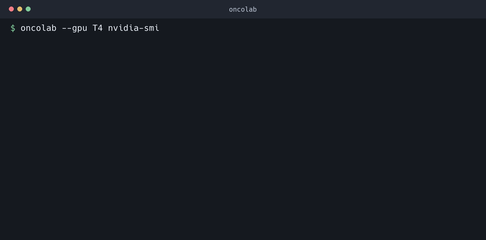

# oncolab

[](https://github.com/progbeat/oncolab/actions/workflows/tests.yml)
[](https://github.com/progbeat/oncolab/releases/latest)
[](https://github.com/progbeat/oncolab/blob/master/pyproject.toml)

Run a terminal command on a fresh Google Colab VM, without writing a notebook.
`oncolab` creates the VM, runs your command, and normally releases the VM when it exits. A profile can
install tools and mount Google Drive before the command starts.

[Quick start](https://github.com/progbeat/oncolab/blob/master/README.md#quick-start) · [Run a command](https://github.com/progbeat/oncolab/blob/master/README.md#run-a-command) · [Configure the VM](https://github.com/progbeat/oncolab/blob/master/README.md#configure-the-vm) · [Troubleshooting](https://github.com/progbeat/oncolab/blob/master/README.md#troubleshooting)



[Open the terminal demo](https://github.com/progbeat/oncolab/blob/demo-media/demo.webp)

## Quick start

On macOS or Linux, you need [uv](https://docs.astral.sh/uv/), OpenSSH, and a
Colab account.

1. If you don't already have the official Colab CLI, install it:
   `uv tool install google-colab-cli`.
2. If you're not signed in to Colab, run `colab sessions` and complete the Google
   sign-in. For the **Colab** connection you need a supported local SSH key, such
   as `~/.ssh/id_ed25519` with its matching `.pub`.
   [SSH setup and key selection](https://github.com/progbeat/oncolab/blob/master/docs/configuration.md#ssh).
3. Install `oncolab` and run your first command:

   ```sh
   uv tool install oncolab
   oncolab echo hello
   ```

Expect `hello`. No config or Drive mount is needed.
To update later, run `uv tool upgrade oncolab`.

## Run a command

```sh
oncolab bash                              # interactive shell; exit when done
oncolab --gpu T4 nvidia-smi                # request a GPU, subject to availability
oncolab -- bash -c 'uname -m && pwd'       # evaluate the shell expression on Colab
oncolab python3 - < train.py              # send a standalone local script over stdin
```

Commands start in `/content`. Local files aren't copied automatically. Save
outputs to persistent storage before the VM is released.

Set `workdir` in your profile to change the VM
working directory, use `--copy` to stage files for the run, or use
`-e NAME=VALUE` to set variables for the command (`-e NAME` forwards an
exported local variable):

```sh
oncolab --gpu T4 --copy train.py --env MODE=train -- python3 train.py
```

Put `oncolab` flags before the
command. See `oncolab --help` for accelerator and memory options.
Use [`-p LOCAL_PORT:REMOTE_PORT`](https://github.com/progbeat/oncolab/blob/master/docs/configuration.md#local-access-to-vm-ports)
to access a VM service from local loopback.

## Configure the VM

Pass `--config path/to/profile.toml`, or save your default profile as
`~/.config/oncolab/config.toml`. Start with the example that matches your task:

- [Install or prepare something before your command](https://github.com/progbeat/oncolab/blob/master/examples/setup.toml): no Drive required.
- [Mount one Google Drive folder](https://github.com/progbeat/oncolab/blob/master/examples/work.toml): use your existing
  rclone config, or [install rclone and run `rclone config`](https://github.com/progbeat/oncolab/blob/master/docs/configuration.md#google-drive-mounts)
  once to create one. oncolab installs rclone and FUSE on the VM if needed;
  it does not require rclone locally once you have a config. Use an unencrypted
  file unless rclone can unlock it noninteractively on the VM. Local password
  helpers and `-e RCLONE_CONFIG_PASS` do not configure the mount.
- [Advanced profiles](https://github.com/progbeat/oncolab/blob/master/docs/configuration.md#examples): multiple mounts with
  separate read/write settings, Git-on, or a wrapper that changes `HOME`.
- [Configuration showcase](https://github.com/progbeat/oncolab/blob/master/examples/showcase.toml): task dependencies,
  file inputs, managed processes, and teardown. The `-v` / `--volume` comment
  describes [future local bind mounts](https://github.com/progbeat/oncolab/issues/4).

[Configuration reference](https://github.com/progbeat/oncolab/blob/master/docs/configuration.md) ·
[Drive permissions and safety](https://github.com/progbeat/oncolab/blob/master/docs/configuration.md#security-and-cleanup)

## Troubleshooting

- If Colab needs credentials, run `colab sessions` in a terminal and complete sign-in. `oncolab` does not hold your command's input open for a hidden login prompt.
- Creating a VM can take several attempts. The progress view shows the current attempt and, on a transient failure, why it is waiting and when it will retry. Use `--attempts N` to set the total (default 4), `--attempts 1` to disable retries, or `--attempts 0` to keep retrying transient failures until Ctrl+C. A rejected accelerator or session-limit response is not retried.
- Use `--debug` for internal diagnostic locations without raw credential data. Output from your own command is not filtered.

- **Command not found:** run `uv tool update-shell` and reopen your terminal.
- **SSH fails:** check [key selection](https://github.com/progbeat/oncolab/blob/master/docs/configuration.md#ssh); `oncolab`
  doesn't read `~/.ssh/config` for the Colab connection.
- **VM cleanup wasn't confirmed:** check `colab sessions`. If the VM is still
  there, use `colab stop -s <session>` only once you know no writes are pending.

[Development](https://github.com/progbeat/oncolab/blob/master/docs/configuration.md#development) · Unofficial; not affiliated with Google.
